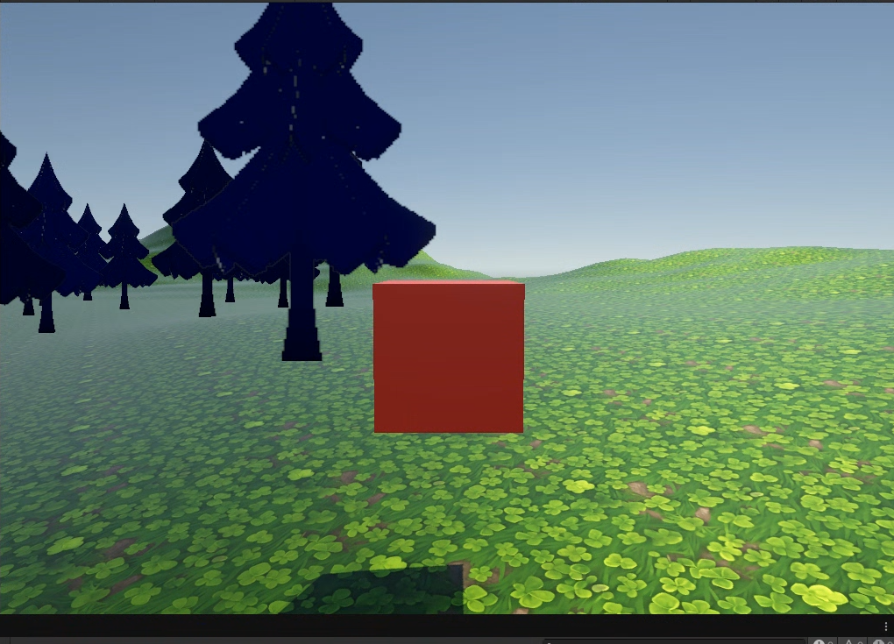
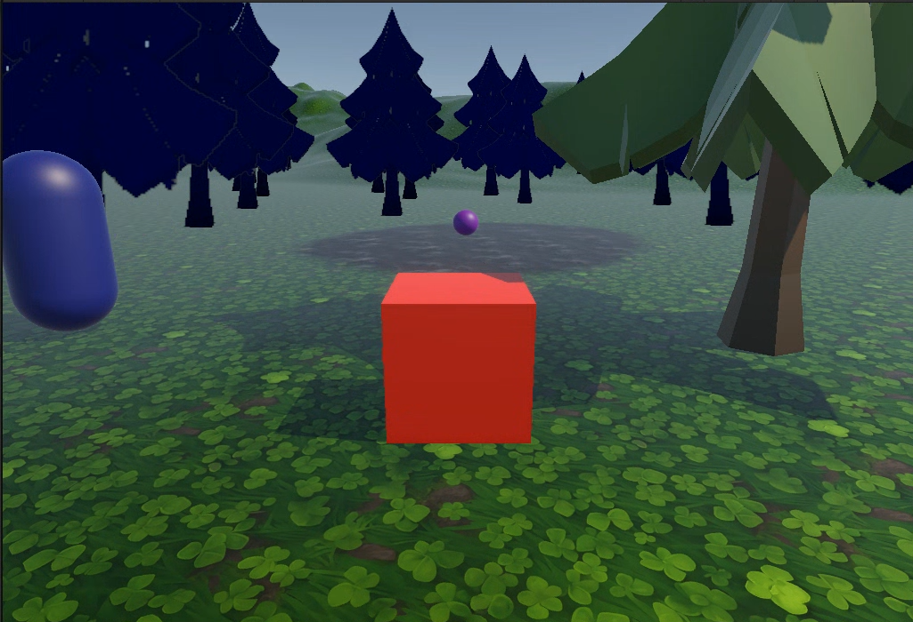
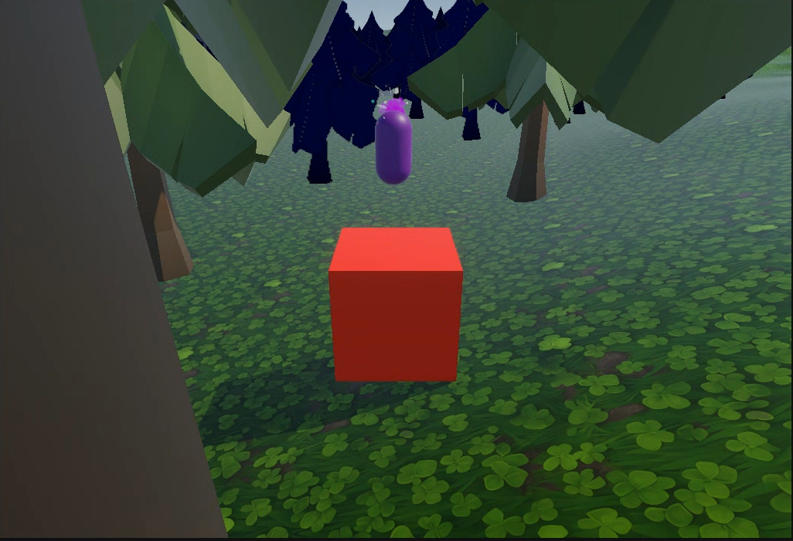
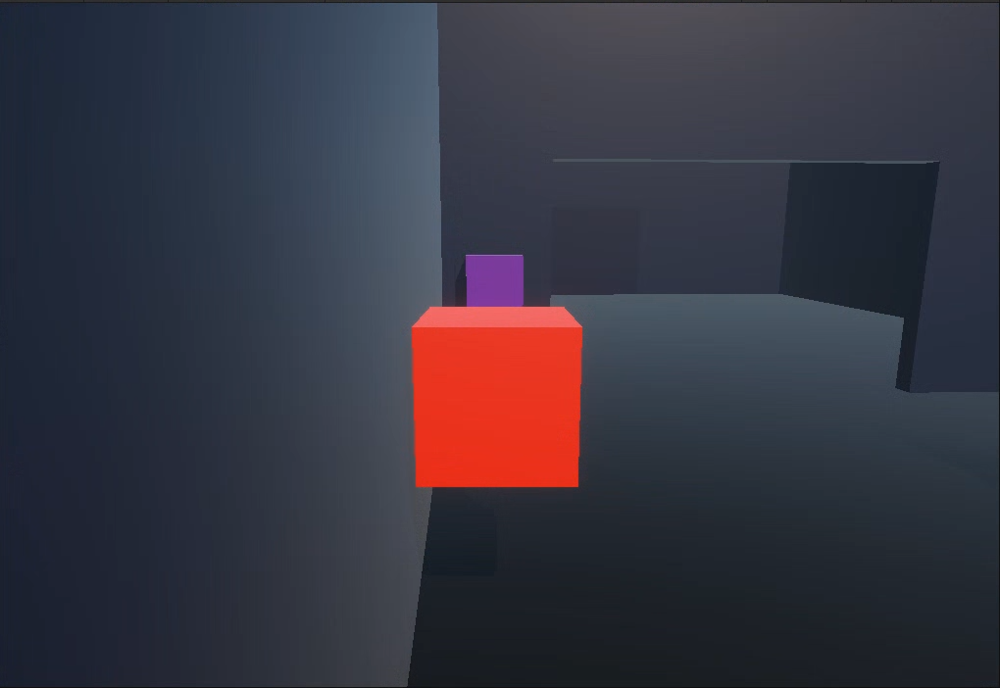
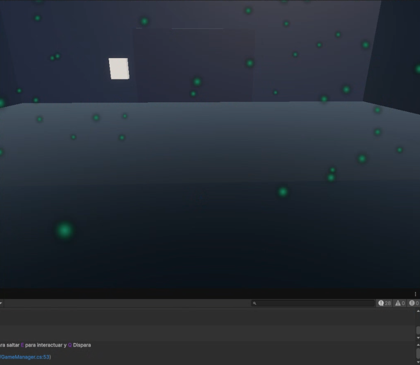
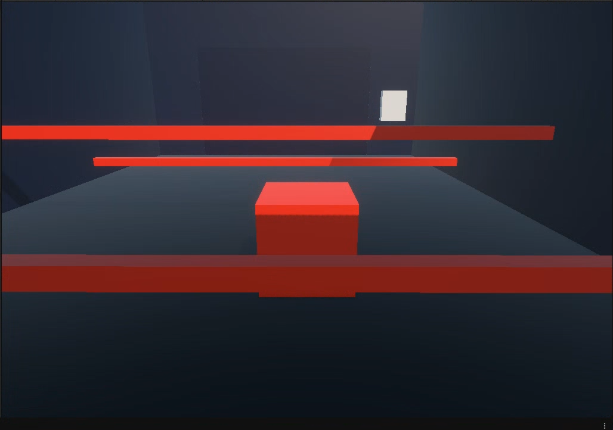
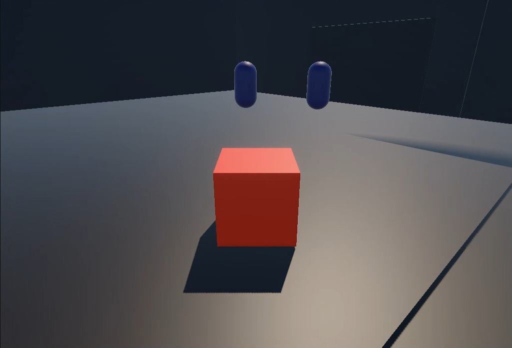
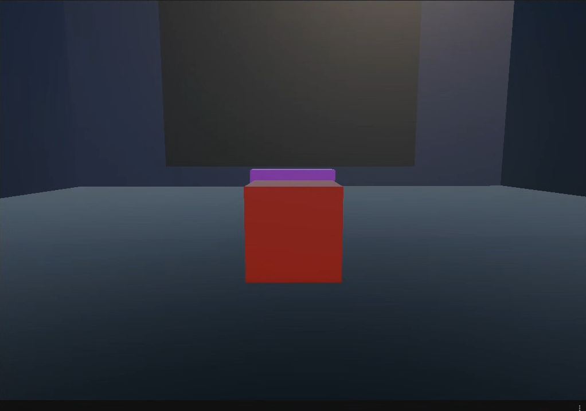
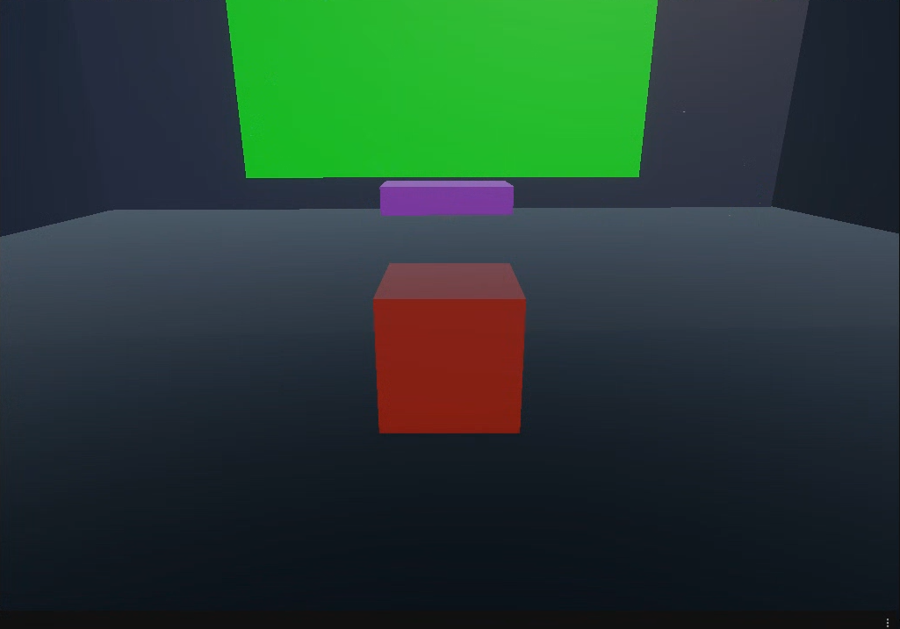
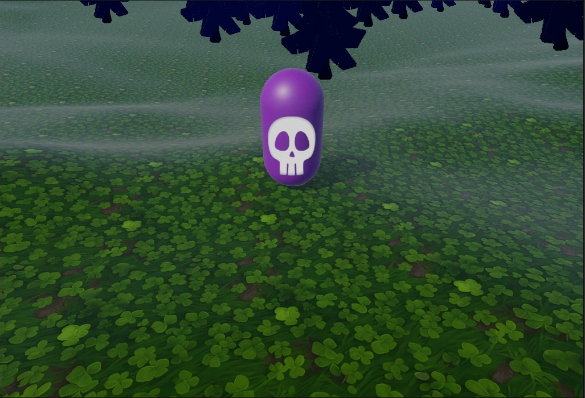

# Metal Gear Solid: Ghost Infiltration
> Asignatura: Programación de Videojuegos I 
Carrera: Tecnicatura Universitaria en Diseño Integral de Videojuegos (TUDIVJ) — UNJu 
Trabajo Práctico N° 2: Integración de mecánicas 3D por Raycast, sistemas de navegación de enemigos con NavMesh, terrenos, gestión de salud/puntuación y control centralizado de juego 
Estudiante: Carla Dalila Angelo 
LU: TUV000563
Equipo Docente: Mg. Ing. Ariel Alejandro Vega | Tecn. Kevin Alexis Roman Llampa

___
## 🛠️ Version de Unity

> Unity: Unity 6.3 LTS
Proyecto: 3D
Lenguaje: C#
___

## 🎮 Descripcion del Proyecto
Metal Gear Solid: Ghost Infiltration es un videojuego de infiltracion y supervivencia inspirado en el genero de sigilo

El jugador debe infiltrarse en una base secreta, explorar el escenario, recolectar fragmentos de informacion y evitar ser detectado por los guardias que patrullan la zona

Para completar la mision, debera utilizar las herramientas disponibles, administrar su salud, aprovechar las oportunidades para aturdir o eliminar enemigos y conseguir acceso a la computadora principal de la base

El objetivo final es reunir la informacion requerida y hackear la terminal principal sin perder toda la salud
___
## 🕹️ Controles del Jugador
| Accion | Tecla/Boton | Descripcion|
|-----|-----------|--------|
| **Movimiento** | `W` , `A` , `S` , `D` / `Flechas` | Mueve al personaje por el escenario |
| **Saltar** | `ESPACIO` | Saltar entre plataformas |
| **Interactuar** | `E` / Contacto con zona (`Trigger`) | Dispara el aturdidor para el enemigo, interactua con objetos y recolecta |
| **Disparar** | `Q` | Dispara balas para eliminar enemigos |
| **Pausar** | `ESC` | Permite pausar o reanudar la partida |
| **Iniciar Partida** | `ENTER` | inicia el juego desde el estado inicial |
___
## ⚙️ Mecanicas
- **Infiltracion y exploracion**
El escenario es un bosque y una base secreta en la cual hay que infiltrarse. Para avanzar, debera explorar el terreno, evitar a los guardias y encontrar los fragmentos de informacion necesarios para completar la mision

- **Enemigos con NavMesh**
Los guardias utilizan NavMeshAgent para desplazarse y perseguir al jugador
Estados del enemigo:
  - Patrulla: recorren puntos establecidos en el escenario
  - Persecucion: detectan al jugador y se desplazan hacia su posicion
  - Ataque: se acercan al jugador y le ocasionan daño cuando se encuentra dentro del alcance
  - Aturdimiento: pueden quedar temporalmente inmovilizados mediante el aturdidor que posee el jugador

- **Interaccion y salto con Raycast**
El jugador utiliza un Raycast para detectar objetos y elementos interactivos que se encuentran delante de él
Al presionar E, puede interactuar con los objetos detectados, recolectar fragmentos de informacion, utilizar consolas y activar el aturdidor cuando apunta a un guardia, se utiliza el sistema de capas (`LayerMask`) para determinar que elementos pueden ser detectados por el Raycast

  Ademas tambien se utiliza para el salto del jugador, utilizando el sistema de capas (`groundLayer`)

- **Aturdidor y disparos**
El jugador cuenta con armas para enfrentarse a los guardias:
  - Aturdidor (`E`): inmoviliza temporalmente a un enemigo y permite aprovechar una oportunidad para avanzar
  - Arma (`Q`): dispara proyectiles capaces de causar daño a los enemigos

  Estas mecanicas permiten elegir cómo afrontar los encuentros durante la infiltracion

- **Recoleccion de informacion**
Durante la exploracion, el jugador debe encontrar fragmentos de informacion distribuidos por el bosque

  Cada fragmento recolectado actualiza el progreso de la mision y suma puntos. Al reunir la cantidad requerida, se habilita el acceso a la base secreta

- **Puertas y consolas de acceso**
Las puertas pueden utilizarse para controlar el avance en la base secreta

  La puerta de la base secreta requiere reunir todos los fragmentos de informacion. Las demas puertas pueden abrirse mediante la interaccion con una consola, sin depender de la recoleccion

  Las puertas temporizadas vuelven a cerrarse despues del tiempo establecido, por lo que el jugador debe aprovechar la oportunidad para atravesarlas

- **Sistema de salud y puntos**
El jugador dispone de una cantidad limitada de salud. Los ataques de los guardias y las trampas quitan daño al jugador. Si la salud llega a cero, se activa el estado de derrota

  Los guardias, tambien tienen un sistema de vida y el cual puede ser derrotado con el arma del jugador
  
  Es posible recolectar puntos al recoger cada dato de informacion, gana 100 puntos. Y al aturdir al guardia, si el jugador lo aturde fuera de su zona de deteccion gana 30, si esta en persecucion 20 y si esta en ataque 5 puntos

- **Requisitos Opcionales**
En mi caso, yo utilize 4 de los requisitos opcionales:
  - Opcion A (Arma por Raycast): Un arma de aturdimiento que proyecte un Raycast frontal para congelar o paralizar al enemigo por unos segundos
  - Opcion C (Trampa de Rayo Laser): Trampas de pared que emitan un rayo continuo que descuente vida si el jugador cruza la linea de deteccion
  - Opción D (Zona de Desaceleracion): Areas delimitadas que reduzcan la velocidad del jugador al entrar a la zona y la restablezcan en cuando salgan
  - Opcion F (Zona de Gas Toxico): Area de peligro donde se descuente vida al jugador paulatinamente mientras permanezca dentro de la zona

- **Estados del Juego**
  - Start: Estado incial del juego, con `ENTER` se inicia el juego
  - Playing: Estado jugando del juego
  - Paused: Estado de pausa, con `ESC` pausa el juego y muestra el progreso del juego. Al presionar nuevamente `ESC` vuelve al estado de jugando
  - Victory: Se alcanza al reunir la informacion necesaria, acceder a la base y activar la consola final. La pantalla cambia de color y se activan los efectos visuales
  - Defeat: Se produce cuando el jugador pierde toda su salud
___
## 📝 Explicacion Tecnica de Codigo:
1. ### Deteccion e Interaccion por Raycast + LayerMask
Script principal: ```PlayerMovement.cs``` y ```PlayerInteraction.cs```
Funcionamiento: Ambos script utilizan el Raycast, y filtra con LayerMask, para controlar el salto y la interaccion con distintos objetos en el escenario

### PlayerMovement.cs
```csharp
void Update()
{
    // Movimiento
    h = Input.GetAxis("Horizontal");
    v = Input.GetAxis("Vertical");
    dir = new Vector3(h, 0, v);

    // Salto
    CheckGround();

    if (Input.GetButtonDown("Jump") && isGrounded)
    {
        rb.AddForce(Vector3.up * jumpForce, ForceMode.Impulse);
    }
}

private void CheckGround()
{
    // Raycast
    Vector3 origin = transform.position; // Origen del Rayo

    // Lanza el rayo
    isGrounded = Physics.Raycast(origin, Vector3.down, rayDistance, groundLayer);

    // Dibujar el raycast (Test)
    Color ColorRay = isGrounded ? Color.green : Color.red;
    Debug.DrawRay(origin, Vector3.down * rayDistance, ColorRay);
}
```

### PlayerInteraction.cs
```csharp
private void Update()
{
    if (hand == null)
        return;

    // Actualiza el origen y la direccion del Raycast
    origin = hand.TransformPoint(offset);
    dir = hand.forward;

    // Resalta el objeto al que estamos apuntando
    UpdateHighlight();
    // Disparo con Q
    if (Input.GetKeyDown(KeyCode.Q))
    {
        Gun gun = GetComponent<Gun>();
        if (gun != null)
        {
            gun.Shoot();
        }
    }

    if (Input.GetKeyDown(KeyCode.E)) // Al presionar E
    {
        isInteractable = false;

        origin = hand.TransformPoint(offset);
        dir = hand.forward;

        // Lanza el rayo
        if (Physics.Raycast(origin, dir, out hit, rayDistance, layer))
        {
            InformationData data = hit.collider.GetComponent<InformationData>();
            if (data != null)
            {
                data.Collect(); // Recolecta
                return;
            }

            EnemyAI enemy = hit.collider.GetComponentInParent<EnemyAI>();

            if (enemy != null)
            {
                StunGun stunGun = GetComponent<StunGun>();

                if (stunGun != null) stunGun.TryStun(enemy); // Aturde al enemigo
                return;
            }

            WinConsole console = hit.collider.GetComponentInParent<WinConsole>();
            if (console != null)
            {
                console.WinPlayer();
            }

            DoorConsole doorConsole = hit.collider.GetComponent<DoorConsole>();
            if (doorConsole != null)
            {
                doorConsole.DoorActive();
            }
        }
    }
}
```

2. ### Navegacion e Inteligencia Artificial con NavMesh
Script principal: ```EnemyAI.cs```
Funcionamiento: Maneja los estados del enemigo, patrulla, persecucion y ataque

### EnemyAI.cs
```csharp
     private void Update()
  {
      // si esta aturdido, el jugador es null o el jugador esta muerto
      if (isStunned || playerTransform == null || (healthSystemPlayer != null && healthSystemPlayer.IsDead))
      {
          agent.isStopped = true; // Se detiene
          return;
      }

      float distanceToPlayer = Vector3.Distance(transform.position, playerTransform.position); // Calcula la distancia del jugador con el enemigo

      switch (currentState)
      {
          case AIState.Patrol: // Patrullaje
              UpdatePatrolState(distanceToPlayer);
              break;

          case AIState.Chase: // Persecucion
              UpdateChaseState(distanceToPlayer);
              break;

          case AIState.Attack: // Ataque
              UpdateAttackState(distanceToPlayer);
              break;
      }
  }

  private void UpdatePatrolState(float distanceToPlayer)
  {
      agent.isStopped = false;

      if (distanceToPlayer <= detectionRadius) // Si el jugador entra en el radio de detección
      {
          currentState = AIState.Chase; // Pasa a persecucion
          return;
      }

      if (!agent.pathPending && agent.remainingDistance <= agent.stoppingDistance)
      {
          if (!isWaitingAtPoint)
          {
              StartCoroutine(WaitAndMoveToNextPoint()); // Si no esta esperando, espera y pasa al otro punto
          }
      }
  }

  private void UpdateChaseState(float distanceToPlayer)
  {
      agent.isStopped = false;
      agent.SetDestination(playerTransform.position); // Sigue al jugador

      if (distanceToPlayer <= attackRadius) // si pasa al radio de ataque
      {
          currentState = AIState.Attack; // Pasa a atacar
          return;
      }

      // Si el jugador se escapa del radio de deteccion, vuelve a patrullar
      if (distanceToPlayer > detectionRadius * 1.2f)
      {
          currentState = AIState.Patrol;
          GoToNextPatrolPoint();
      }
  }

  private void UpdateAttackState(float distanceToPlayer)
  {
      // Hace que el enemigo mire hacia el jugador
      transform.LookAt(new Vector3(playerTransform.position.x, transform.position.y, playerTransform.position.z));

      if (distanceToPlayer > attackRadius && !isAttacking) // Si no ataca y el jugador pasa la zona de ataque
      {
          currentState = AIState.Chase; // Vuelve a persecucion
          return;
      }
      if (!isAttacking)
      {
          StartCoroutine(AttackCooldown()); // Espera unos segundos
      }
  }
```

3. ### Sistema de Salud, Daño y Puntuacion
Script principal: ```HealthSystem.cs``` y ```GameManager.cs```
Funcionamiento: Se encargan del daño al jugador y al guardia, la recoleccion de puntos y enseña por consola

### HealthSystem.cs
```csharp
   public void TakeDamage(float amount)
   {
       damage = amount;
       if (isDead || amount <= 0f) return;
       currentHealth -= amount;
       currentHealth = Mathf.Clamp(currentHealth, 0, maxHealth);

       if (gameObject.CompareTag("Player"))
       {
           Debug.Log($"<color=#FF3434>-{damage} de vida</color>");
           Debug.Log($"<color=#FF3434>Tienes {currentHealth}% de vida</color>");
       }
       if (gameObject.CompareTag("Guard"))
       {
           Debug.Log($"<color=#7E00EC>-{damage} de vida al enemigo</color>");
       }

       if (currentHealth <= 0f)
       {
           Dead();
       }
       else
       {
           FlashDamage(); // Efecto de daño
       }
   }

   public void Dead()
   {
       if (isDead) return;
       isDead = true;

       vfx.SetActive(true);
       StartCoroutine(DestroyTransition());
   }
```

### GameManager.cs
```csharp
public void ShowStatus() // Da la info por consola
{
    if (health != null)
    {
        Debug.Log(
            $"<color=#FF3434> Vida: <color=white>{health.CurrentHealth}% </color></color>" +
            $"<color=cyan> Fragmentos: <color=white>{collectedData} / {requiredData} </color></color>" +
            $"<color=yellow> Puntos: <color=white>{score}</color></color>\n" +
            $"<color=purple>----- ESTADO DE LA MISION -----</color>"
            );
    }
}

public void CollectData(int points)
{
    if (collectedData >= requiredData) // Si llega a los datos requeridos
    {
        return;
    }

    collectedData++; // Suma datos
    score += points; // Suma puntos

    // Debug
    Debug.Log($"<color=cyan>Datos: </color><color=white>{collectedData} / {requiredData}</color>");

    Debug.Log($"<color=#FFD700>Puntos: </color><color=white>{score}</color>");
}

public void AddScore(int points)
{
    score += points;
    Debug.Log($"<color=#FFD700>Puntos: </color><color=white>{score}</color>");
}
```
5. ### GameManager y Control de Estado
Script principal: ```GameManager.cs```
Funcionamiento: El Script maneja los estados del juego

### GameManager.cs
```csharp
       void Update()
   {
       if (collectedData >= requiredData && !openedDoor)
       {
           OpenDoor();
           openedDoor = true;
       }

       switch (currentState)
       {
           case GameState.Start:
               if (Input.GetKeyDown(KeyCode.Return)) ChangeState(GameState.Playing);
               break;
           case GameState.Playing:
               if (Input.GetKeyDown(KeyCode.Escape)) ChangeState(GameState.Paused);
               break;
           case GameState.Paused:
               if (Input.GetKeyDown(KeyCode.Escape)) ChangeState(GameState.Playing);
               break;
       }
   }

   public void ChangeState(GameState newState)
   {
       if (currentState == newState) return;
       currentState = newState;

       if (currentState == GameState.Start || currentState == GameState.Paused || currentState == GameState.Victory || currentState == GameState.Defeat)
       {
           Time.timeScale = 0f;
           ShowStatus();
       }
       else
       {
           Time.timeScale = 1f;
       }
   }
```

6. ### Requisitos Opcionales 
Script principal: ```StunGun.cs```, ```LaserTrap.cs```, ```MudZone.cs``` y ```ToxicGas.cs```
Funcionamiento: 

### StunGun.cs
```csharp
        public void TryStun(EnemyAI enemy)
{
    if (enemy == null || enemy.IsStunned) return;

    if (enemy.HasAwardedStunPoints) // No se otorgan puntos mas de una vez
    {
        enemy.Stun(stunDuration);
        Debug.Log("<color=red>Sin puntos extra</color>");
        return;
    }

    float distance = Vector3.Distance(transform.position, enemy.transform.position); // Distancia del jugador al enemigo

    int points;

    if (enemy.CurrentState == EnemyAI.AIState.Attack) // Al entrar en ataque
    {
        points = attackPoints;
    }
    else if (distance > enemy.DetectionRadius) // Al estar lejos del enemigo
    {
        points = stealthPoints;
    }
    else // Al ser detectado
    {
        points = detectedPoints;
    }

    enemy.Stun(stunDuration); // Aturde al enemigo

    enemy.MarkStunPointsAwarded(); // Ya se dieron los puntos

    if (gameManager != null)
    {
        gameManager.AddScore(points); // Suma puntos
    }

    Debug.Log($"<color=#FFD700>¡Guardia aturdido! +{points} puntos</color>");
}
```

### LaserTrap.cs
```csharp
    void Start()
{
    col = GetComponent<Collider>();
    rer = GetComponent<Renderer>();
    InvokeRepeating("ToggleLaser", blinkTimeInit, blinkTime);
}

private void ToggleLaser()
{
    isActive = !isActive;
    col.enabled = isActive;
    rer.enabled = isActive;
}

private void OnTriggerEnter(Collider other)
{
    if (!isActive) return;
    if (!other.gameObject.CompareTag("Player")) return;

    HealthSystem health = other.gameObject.GetComponent<HealthSystem>();

    if (health == null) return;

    health.TakeDamage(damage); // Daña al jugador
}
```
### MudZone.cs
```csharp
    private void OnTriggerEnter(Collider other)
    {
        player = other.GetComponentInParent<PlayerMovement>();

        if (player != null)
        {
            player.SetInMud(true);
        }
    }

    private void OnTriggerExit(Collider other)
    {
        player = other.GetComponentInParent<PlayerMovement>();

        if (player != null)
        {
            player.SetInMud(false);
        }
    }
```
### ToxicGas.cs
```csharp
    private void OnTriggerStay(Collider other)
    {
        if (!other.gameObject.CompareTag("Player")) return;
        health = other.gameObject.GetComponent<HealthSystem>();
        if (health == null) return;

        timer += Time.deltaTime;
        if (timer >= damageInterval)
        {
            health.TakeDamage(damage);
            timer = 0f;
        }
        foreach (var g in gas)
        {
            g.Play();
        }
    }

    private void OnTriggerExit(Collider other)
    {
        if (!other.gameObject.CompareTag("Player")) return;
        health = null;
        timer = 0f;
        foreach (var g in gas)
        {
            g.Stop();
        }
    }
```
7. ### Sistema de puertas
Script principal: ```WinConsole.cs``` y ```DoorConsole.cs```
Funcionamiento: Manejan el sistema de puertas, botones y el evento de victoria

### WinConsole.cs
```csharp
            public void WinPlayer()
    {
        if (missionCompleted) return;

        if (GameManager.Instance == null) return;

        if (!GameManager.Instance.HasRequiredData())
        {
            return;
        }

        missionCompleted = true;

        // La pantalla se vuelve verde
        if (rend != null) rend.material.color = Color.green;

        foreach (GameObject explosion in explosions)
        {
            if (explosion != null)
                explosion.SetActive(true);
        }
        StartCoroutine(Transition());
    }
```
### DoorConsole.cs
```csharp
    public void DoorActive()
    {
        if (doorOpened) return;
        if (mision)
        {
            if (GameManager.Instance == null || !GameManager.Instance.HasRequiredData()) return;
        }

        StartCoroutine(OpenedDoor());
    }
```
8. ### Arma
Script principal: ```Gun.cs``` y ```Bullet.cs```
Funcionamiento: Manejan el arma que tiene el jugador

### Gun.cs
```csharp
    public void Shoot()
    {
        if (bullet == null) return;

        // Instantiate (gameObject, posicion, rotacion)
        GameObject newBullet = Instantiate(bullet, point.position + offset, point.rotation); // Crea bala
        Destroy(newBullet, 4f); // Destruye la bala despues de un tiempo
    }
```
### Bullet.cs
```csharp
    public void DoorActive()
    {
        if (doorOpened) return;
        if (mision)
        {
            if (GameManager.Instance == null || !GameManager.Instance.HasRequiredData()) return;
        }

        StartCoroutine(OpenedDoor());
    }
```
___

## 📸 Capturas de Pantalla
### Bosque




### Base Secreta






### Victoria


___

## ▶️ Como abrir y ejecutar el proyecto

1. Descargar o clonar el repositorio desde GitHub.
2. Abrir Unity Hub.
3. Seleccionar **Add project from disk** y elegir la carpeta del proyecto
4. Abrir el proyecto utilizando **Unity 6.3 LTS**
5. Abrir la escena principal ubicada en `Assets/Scenes/`
6. Presionar **Play** para ejecutar el juego
7. Utilizar los controles indicados en la seccion **Controles del Jugador**
___
## 📚 Bibliografia
- [README.md - Markdown](https://markdown.es)
- [Material de clase — Programacion de Videojuegos I](https://virtual.unju.edu.ar/course/view.php?id=2520)
- [Material dado por el profesor Kevin Alexis Roman Llampa](https://github.com/Kivito3d/TP2_PVJ1_2026)
- Apuntes y ejemplos dados durante las clases de Programacion de Videojuegos I